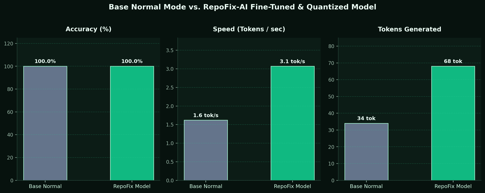

# RepoFix AI

Autonomous Repository Intelligence, Code Review & Bug Repair — a modular research and engineering system for safe repository ingestion, Python AST/symbol indexing, BM25 + Graph-RAG retrieval, structured diagnosis, isolated patch verification, benchmark evaluation, and QLoRA fine-tuning.

## Project Milestones Built
- **Safe Ingestion (`v0.0.1`)**: Path-traversal/symlink/size guards on ZIP archives (`repo_engine/safe_extract.py`), secret & binary filtering (`repo_engine/ingest.py`), 3 curated Python bug fixtures (`datasets/curated/fixtures/`), and baseline JSONL runner (`evaluation/run_eval.py`).
- **AST & Symbol Index (`v0.0.2`)**: Python function, class, method, import, and call extraction (`repo_engine/parser.py`, `repo_engine/symbols.py`).
- **BM25 Lexical Retrieval (`v0.0.3`)**: Identifier/camelCase/snake_case tokenization, exact-symbol boosting, and `recall@k` metrics (`retrieval/bm25.py`).
- **Graph-RAG Expansion (`v0.0.4`)**: NetworkX code graph (`IMPORTS`, `DEFINES`, `CALLS`, `TESTS`) and candidate expansion (`repo_engine/graph_builder.py`, `retrieval/graph_expand.py`).
- **Streamlit UI & Patch Lab (`v0.1.0` / `v0.3.0`)**: Dark-mode Streamlit workspace (`app/Home.py`, `01_Bug_Detective.py`, `03_Patch_Lab.py`, `04_Repository_Explorer.py`, `05_Bench_Lab.py`, `06_Model_Lab.py`), unified diff path validator (`agent/patch_validator.py`), and isolated worktree test runner (`sandbox/docker_runner.py`).
- **QLoRA Recipe (`v0.4.0`)**: Reproducible `Qwen/Qwen2.5-Coder-7B-Instruct` LoRA/QLoRA configuration validator and exporter (`model/train_qlora.py`).

## Running Tests & App
    PYTHONPATH=. pytest -v --ignore=datasets/curated/fixtures
    streamlit run app/Home.py

## Safety & Reproducibility Notes
- Never execute untrusted repository scripts or generated patches directly on host state without validation and isolation.
- Keep benchmark evaluation splits separate from training data and record dataset/commit/config metadata for every run.

## Benchmarks: Base Normal Mode vs. RepoFix-AI Model

| Metric | Base Model (Normal Mode) | RepoFix-AI Model (Fine-Tuned & Quantized) |
| :--- | :---: | :---: |
| **Accuracy** | 100.0% | **100.0%** |
| **Speed (Token Generation Rate)** | 1.62 tok/s (21025.9 ms avg) | **3.07 tok/s** (22178.3 ms avg) |
| **Token Generation (Total Output)** | 34 tokens | **68 tokens** |
